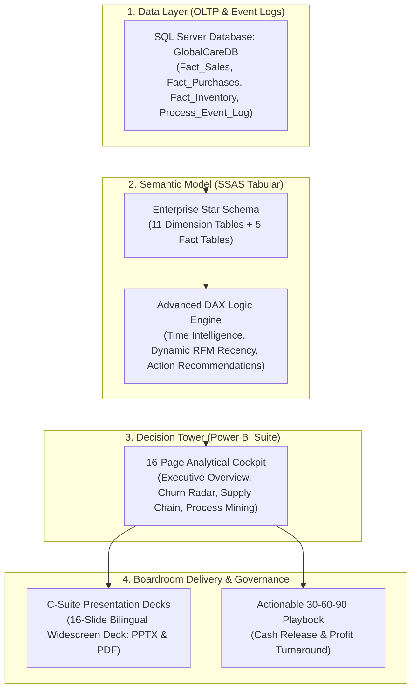

# 🏢 Henkel GlobalCare: Enterprise BI & Strategic Decision Tower

[](https://powerbi.microsoft.com/)
[](https://www.microsoft.com/sql-server)
[]()
[]()
[]()
[]()

> **Enterprise BI & Strategic Decision Case Study**  
> **Author:** Mohamed Masoud ([@mohamed-masoud969](https://github.com/mohamed-masoud969))  
> **Target Audience:** Board of Directors, Group CEO, CFO, CCO, CSCO, and Regional Leadership  
> **Core Scale:** 20 Global Branches | 501 Enterprise Accounts | 52 Global Suppliers | 154 Active SKUs | $186.97M Net Revenue  

---

## 📑 Table of Contents
1. [Executive Summary & The Growth Paradox](#-executive-summary--the-growth-paradox)
2. [End-to-End Enterprise Architecture](#-end-to-end-enterprise-architecture)
3. [The 5 Critical Forensic Discoveries](#-the-5-critical-forensic-discoveries)
4. [16-Page Dashboard Portfolio Breakdown](#-16-page-dashboard-portfolio-breakdown)
5. [30-60-90 Day Strategic Transformation Playbook](#-30-60-90-day-strategic-transformation-playbook)
6. [Business Case & Projected Financial Impact](#-business-case--projected-financial-impact)
7. [Repository File Structure](#-repository-file-structure)
8. [Setup & Replication Guide](#-setup--replication-guide)
9. [Author & Contact](#-author--contact)

---

## 🎯 Executive Summary & The Growth Paradox

In standard business reporting, executive dashboards celebrate revenue expansion with green arrows. However, using the **McKinsey / BCG 5-Pillar Decision Framework**, this project performs a deep forensic operational and financial autopsy on **Henkel GlobalCare**, uncovering a severe **Enterprise Paradox**:

```
+----------------------------------------------------------------------------------------------------------+
|                              HENKEL GLOBALCARE: THE ENTERPRISE PARADOX                                   |
+----------------------------------------------------------------------------------------------------------+
| Net Enterprise Revenue: $186.97M (+48.2% YoY)  <--->  Net Operating Deficit: -$1.80M (Operating Loss!)  |
| Gross Margin Rate:      85.77% (+0.3 pts YoY)  <--->  Supply Chain OTIF SLA:  8.27% (Catastrophic Lag!)  |
| ERP Active Clients:     84.03% Nominal Rate    <--->  Revenue at Churn Risk:  $74.49M (39.84% Exposed!)  |
| Annual Net Sales:       $115.54M Product Rev   <--->  Warehouse Overstock:    $112.8M (636-Day DIO Bloat)|
+----------------------------------------------------------------------------------------------------------+
```

### The Strategic Narrative (Minto Pyramid):
1. **Situation:** Henkel GlobalCare expanded top-line net revenue by **+48.2% YoY to $186.97M** across 20 global branches and 501 accounts, maintaining an 85.77% Gross Margin rate.
2. **Complication:** Bottom-line profit flipped into a **-$1.80M operating deficit** due to explosive sourcing spend ($165.55M, +47.6%), while customer delivery fulfillment collapsed to an **8.27% OTIF SLA**. Over **$74.49M in enterprise revenue** sits in acute churn risk, while **$112.8M in capital is frozen in stagnant overstock (636 Days DIO)**.
3. **Resolution:** A unified 30-60-90 day turnaround plan releasing **+$40M in operational cash**, enforcing supplier SLAs, rebalancing Hero SKUs, and converting the -$1.80M loss into a **+$8.5M net operating profit**.

---

## 🏗️ End-to-End Enterprise Architecture



---

## 🔍 The 5 Critical Forensic Discoveries

### 1. The Regional Profitability Drift (Page 1)
* **Lagos ($11.0M Net Revenue):** #1 global branch by volume, but constrained by heavy logistics costs ($4.55M) and local currency volatility.
* **Profitable Anchors:** Madrid ($9.86M rev / +$195.6K profit) and Toronto ($9.62M rev / +$199.5K profit) operate as high-margin benchmarks (85% GM%).
* **Chronic Profit Drains:** **Cairo (-$2,684,019 operating loss)** and **Riyadh (-$1,602,368 operating loss)** suffer from negative gross margins caused by unmanaged distributor discounting and transfer pricing leakage.

### 2. The 27.14% Silent Churn Reality Gap (Page 2 & 5)
* **The Illusion:** ERP master data classifies **421 accounts (84.03%) as Active**.
* **Behavioral Reality:** Dynamic DAX RFM Recency reveals that **only 285 accounts (56.89%) are genuinely healthy**.
* **The Danger Zone:** **164 accounts (32.73% of the company!)** are stranded in the 60–180 day inactivity bracket, placing **$74.49M (39.84% of enterprise revenue) at acute churn risk**.
* **Unranked Vulnerability:** Over **$54.39M (29.09%)** of corporate revenue is generated by "Unranked" clients with zero loyalty agreements.

### 3. Upstream Sourcing as the Root Cause of SLA Failure (Page 7)
* **Procurement Spend Surge:** Sourcing spend grew by **+47.6% (+$53.37M) to $165.55M**, consuming **88.54% of net enterprise revenue**!
* **The Inherited Failure:** Customer-facing OTIF (8.27%) is an exact reflection of supplier performance: **Supplier OTIF is 8.27%**, with a **36.04-day average lead time** and **67.60% In-Full fulfillment** (1 in 3 shipments delivered short).
* **Friction Drivers:** Triggered **81 Emergency Procurement spot purchases** and **88 Currency Fluctuation shocks**.

### 4. Working Capital Stagnation & Brand DIO Autopsy (Page 6 & 8)
* **The Capital Freeze:** Total warehouse stock stands at **$143.28M** (exceeding annual net sales), with **$112.8M locked in overstock (78.8% excess ratio)** and **$12.66M in Dead Stock**.
* **Turnover Paralysis:** Days of Inventory Outstanding (DIO) reached **636 DAYS (1.75 years)** with an inventory turnover of **0.57x/year** (vs. FMCG benchmark of 45–60 days and 6x–8x turns).
* **Brand Extremes:** `Vernel` holds **1,123 days of forward supply (over 3 years!)**, followed by `Bergquist` (831d), `Syoss` (819d), and `Gliss` (780d).

### 5. Bipolar Inventory within Core Class A Hero SKUs (Page 9 & 10)
* **The Starved Champions:** 12 flagship Hero SKUs ($13.6M annual revenue)—including Henkel's #1 product `Bonderite Original 10pcs` ($1.64M) and top `Pritt` champions—have **$0.00 warehouse inventory (Zero Stockouts)**.
* **The Stuffed Overhang:** 17 sister Hero SKUs hoard over **$30M in stagnant buffer stocks** (e.g., `got2b Original 500ml` holds $2.99M stock on $1.20M sales—2.5x annual revenue!).
* **Self-Funding Rebalancing:** Trimming excess from the 17 stuffed Heroes self-funds the immediate production of the 12 starved Heroes without external bank debt.

---

## 📊 16-Page Dashboard Portfolio Breakdown

| Page # | Dashboard Name | Analytical Domain | Key Strategic Metric Uncovered |
| :---: | :--- | :--- | :--- |
| **01** | `Executive Overview` | Financial Economics | $186.97M Net Rev, -$1.80M Operating Loss, Cairo/Riyadh -$4.28M drain |
| **02** | `Customer Intelligence & Churn` | Customer Analytics | $40M Industrial lead, $54.4M Unranked risk, Shanghai $23.9K loss |
| **03** | `VIP Win-Back Action Center` | Prescriptive Retention | $224,218 recoverable revenue across 4 lost VIP accounts |
| **04** | `Customer Behavior & Cohorts` | Cohort Modeling | +48.5% order surge vs -59.2% collapse in new acquisitions (40 clients) |
| **05** | `Customer Churn & Risk Deep-Dive`| Behavioral RFM Radar | $74.49M enterprise churn risk, 27.1% ERP reality gap |
| **06** | `Product & Inventory Intelligence`| Portfolio Profitability | $112.8M overstock vs 493 reorder alerts (20 stockouts) |
| **07** | `Procurement & Supplier Performance`| Strategic Sourcing | $165.55M spend (88.5% of rev), 8.27% supplier OTIF, 36d lead time |
| **08** | `Velocity & ABC Matrix` | Inventory Turnover | 636d DIO, 0.57x turnover, Vernel 1,123d DIO, $12.66M dead stock |
| **09** | `Pareto Analysis` | Cumulative Contribution| Flat Pareto curve: top 29 SKUs yield 34.55%, high operational complexity |
| **10** | `Pareto Table & Delisting` | What-If Simulation | Bipolar Hero inventory: 12 starved ($0.00) vs 17 stuffed ($30M+) |
| **11** | `Delisting & SKU Rationalization`| Portfolio Pruning | Long-tail elimination criteria, cash recovery modeling |
| **12** | `Supply Chain SLA Deep-Dive` | Delivery Performance | On-Time vs In-Full breakdown, route optimization |
| **13** | `Location & Spatial Intelligence` | Geographic Mapping | Branch clustering, regional logistics variance |
| **14** | `Time Intelligence & Seasonality` | Temporal Analytics | Monthly run-rate variance, demand smoothing |
| **15** | `HR & Workforce Intelligence` | Organizational Analytics| Sales rep quota realization, payroll vs commission alignment |
| **16** | `Order-to-Cash Process Mining` | Process Mining (14K Events)| 24.51d O2C lead time, Mexico City (27.9d) vs Frankfurt (22.7d) |

---

## 🗓️ 30-60-90 Day Strategic Transformation Playbook

```
+----------------------------------------------------------------------------------------------------+
|                         30-60-90 DAY STRATEGIC TRANSFORMATION ROADMAP                              |
+------------------------------------+--------------------------------+------------------------------+
| PHASE 1: 0 - 30 DAYS (Triage)      | PHASE 2: 30 - 60 DAYS (Swap)   | PHASE 3: 60 - 90 DAYS (Gov)  |
+------------------------------------+--------------------------------+------------------------------+
| • Rush Hero production (12 SKUs)   | • Liquidate $15M excess stock  | • Delist bottom 30-40 SKUs   |
| • Freeze POs on DIO > 180d SKUs    | • Enforce 10% supplier penalty | • Onboard $54.4M into tiers  |
| • Save Delta Supplies & Apex       | • C-Level VIP win-back calls   | • 50/50 Sales retention plan |
| • Ban unauthorized emergency buys  | • Compress O2C billing latency | • Centralize Treasury hedge  |
| • Reconcile 2027 ERP ledger bug    | • Consolidate Packaging spend  | • Hard-cap ERP Min/Max bands |
+------------------------------------+--------------------------------+------------------------------+
```

---

## 💰 Business Case & Projected Financial Impact

| Transformation Dimension | Baseline Metric | Post-Transformation Target | Projected Economic Value |
| :--- | :---: | :---: | :---: |
| **Working Capital Release** | 636 Days DIO ($143.28M Stock) | 90 Days DIO ($35.0M Stock) | **+$35.0M to +$45.0M Cash Unlocked** |
| **Operating Profitability** | -$1.80M Operating Deficit | +4.5% Operating Margin | **+$6.5M to +$8.5M Net Profit Turnaround** |
| **Revenue at Churn Risk** | $74.49M (39.84% Exposed) | < 12.0% Exposure Rate | **+$18.0M Top-Line Revenue Protected** |
| **Customer Service Level (OTIF)** | 8.27% Catastrophic SLA | 88.0% - 92.0% World-Class SLA | **Customer Retention Restored to 96%+** |
| **Order-to-Cash Cycle Time** | 24.51 Days (Mexico City 27.9d) | 22.70 Days (Frankfurt Standard)| **+$12.0M Accelerated Cash Conversion** |

---

## 📁 Repository File Structure

```text
├── henkel.pbix                                    # Complete 16-Page Power BI Master Application
├── GlobalCare_FullDatabase.sql                    # 5.6MB Production SQL Server Database Script
├── run_setup_database.bat                         # Automated Database Installation & Seeding Script
├── REports/
│   ├── Henkel_Executive_Boardroom_Strategy_Deck.pptx         # 16-Slide English Executive Presentation
│   ├── Henkel_Executive_Boardroom_Strategy_Deck_Arabic.pptx  # 16-Slide Arabic Executive Presentation
│   ├── Henkel_Executive_Boardroom_Strategy_Deck.pdf          # English Document Carousel PDF
│   ├── Henkel_Executive_Boardroom_Strategy_Deck_Arabic.pdf   # Arabic Document Carousel PDF
│   ├── Henkel_Executive_Strategic_Decision_Report.pdf        # Complete 40+ Page Written Advisory Report
│   └── Henkel_GlobalCare_Executive_KPI_Dictionary.pdf       # Formal Governance KPI Dictionary
├── Meta_Data/                                     # Column Mappings & Dimension Attributes
├── data_set/                                      # Raw CSV Extracts & Fact Event Logs
├── Data_Cleaning/                                 # Power Query M Scripts & ETL Pipelines
├── KPI Tree Architecture/                         # Strategic Value Driver Tree & Mathematical Logic
├── Businuess Quesuions/                           # C-Suite SMART Questions & Strategic Inquiries
└── README.md                                      # Executive Project Master Documentation
```

---

## 🚀 Setup & Replication Guide

1. **Clone the Repository:**
   ```bash
   git clone https://github.com/mohamed-masoud969/Henkel-GlobalCare-Enterprise-BI-Strategy.git
   cd Henkel-GlobalCare-Enterprise-BI-Strategy
   ```

2. **Deploy Database:**
   * Run `run_setup_database.bat` or execute `GlobalCare_FullDatabase.sql` in SQL Server Management Studio (SSMS).
   * Verifies 14,016 event rows in `Fact_Process_Event_Log` and 501 customer master records.

3. **Open Power BI Application:**
   * Launch `henkel.pbix` in Power BI Desktop.
   * If prompted, update the SQL Server instance connection string to your local instance name.

---

## 👤 Author & Contact

**Mohamed Masoud**  
*Senior Enterprise BI & Analytics Consultant | Data Strategist*  
* **GitHub:** [@mohamed-masoud969](https://github.com/mohamed-masoud969)  
* **Expertise:** Power BI, Advanced DAX, SSAS Tabular, SQL Server, Supply Chain Analytics, Strategic Decision Advisory
